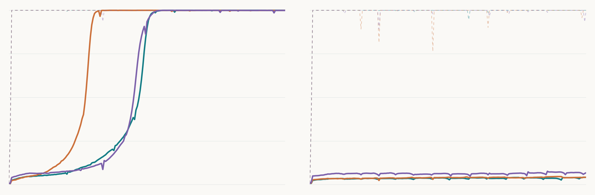
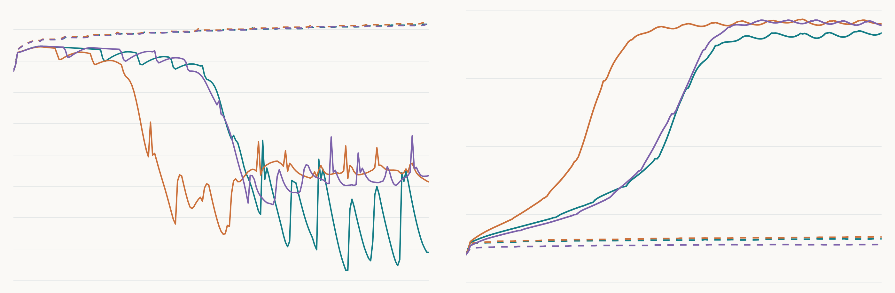

крч обучил трансформер считать `(a + b) mod 113`, дал ему 3830 пар из 12 769, остальные 8939 оставил для проверки и сделал по три запуска с weight decay 1 и без него



слева weight decay 1, справа 0, по горизонтали шаги от 0 до 20 000, по вертикали точность от 0 до 100%, бирюзовый это seed 0, оранжевый 1, фиолетовый 2, пунктир показывает обучение, сплошные линии показывают новые пары

обучение все выучили примерно на шаге 200, но новые пары слева начали нормально решать только через несколько тысяч шагов, справа за это время почти ничего не поменялось

| seed | новые пары, wd 1 | новые пары, wd 0 | шаг до 99%, wd 1 |
|---|---:|---:|---:|
| 0 | 100% | 4,22% | 10 700 |
| 1 | 99,96% | 4,25% | 6 700 |
| 2 | 99,93% | 6,80% | 10 600 |

99% считаю достигнутыми после пяти проверок подряд, проверял каждые 100 шагов и записал первый шаг этой серии, в таблице точность на новых парах в конце обучения

один слой, ширина 128, 4 головы, MLP 512 с ReLU, без LayerNorm, dropout и bias, эмбеддинги входа и выхода отдельные, инициализация Normal со std `0.8 / sqrt(128)`, AdamW с lr `0.001` и betas `(0.9, 0.98)`, weight decay на все параметры, полный батч, FP32 без TF32, 20 000 шагов, seed разбиения 2026

запускал на RTX PRO 5000 Blackwell, Python 3.12.3 и PyTorch 2.8.0+cu128, каждый запуск занял около 58 секунд, графики через Matplotlib 3.11.2



тут слева loss на новых парах в логарифмической шкале, справа энергия пяти самых сильных ненулевых частот эмбеддингов от 0 до 100%, по горизонтали те же 20 000 шагов, цвета те же, сплошные линии это wd 1, пунктир это wd 0, спектр сам по себе ещё не доказывает какой алгоритм выучила модель

чтобы повторить, нужны PyTorch под свою видеокарту и новые папки результатов, старые скрипт не перезаписывает

```bash
pip install -r requirements.txt
python code/train.py --validate
bash code/run_pair.sh
python analyze.py .
```

веса лежат в [релизе](https://github.com/abdumutalipabay0/grokking-experiment/releases/tag/experiment-01), после распаковки архива можно запустить `python code/verify.py .`, точность из финальных весов уже пересчитана и совпала с логами

тут три seed и одно разбиение, отдельного финального теста нет, контроль мог бы обобщить позже 20 000 шагов, гиперпараметры по этим результатам не менял

ориентировался на [Power et al.](https://arxiv.org/abs/2201.02177) и [Nanda et al.](https://arxiv.org/abs/2301.05217), это своя версия эксперимента с другой инициализацией, без bias, с FP32 loss и 20 000 шагов вместо 40 000
